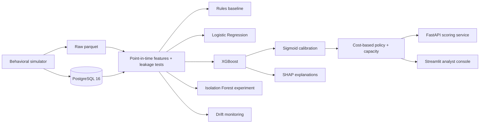

# FraudLens

[](https://github.com/rutujkale/fraudlens/actions/workflows/ci.yml)

An end-to-end **fraud-risk decision system**: a behavioral transaction simulator →
PostgreSQL → point-in-time features (with leakage tests) → Rules / Logistic
Regression / XGBoost under temporal validation → probability calibration →
cost-based decision policy with analyst-capacity limits → Isolation Forest
unseen-fraud experiment → SHAP → FastAPI + Streamlit → monitoring.

Synthetic data only (plus one public benchmark). This is a **portfolio / research
system, not a production banking system** — no claim of production readiness is
made anywhere.

> Every number below is filled from `results/final_results.json` and
> `results/latency.json` by `scripts/render_readme.py`; nothing here is typed by
> hand. The template is `docs/readme_template.md`.

## Why fraud risk is a different problem

- **Frauds are rare.** Test prevalence is 0.00987
  (393 frauds in 39823 rows). Accuracy is
  meaningless, so PR-AUC, recall@top-K and expected cost are the headline metrics.
- **Legitimate behavior looks fraudulent.** Hard negatives (travel, payday,
  device sharing) are simulated explicitly and measured, not ignored.
- **Patterns move.** The fraud mix shifts over the timeline, so evaluation is
  strictly temporal with an embargo, and drift is a first-class finding.
- **Analysts are limited.** Reviews are capped per day; the policy trades fraud
  loss against friction and review workload.

## What I built



## What I found

Four pre-registered outcomes (`results/final_results.json`:

`pre_registered_outcomes`).

1. **Model.** Frozen XGBoost test PR-AUC 0.9619 (CI 0.9340-0.9798), ahead of
   LogReg 0.8873 (CI 0.8383-0.9233) and far ahead of the rules baseline
   0.2036 (CI 0.0873-0.3492) at 0.987%
   prevalence. With 393 test frauds the PR-AUC CI is wide, so
   read the point estimate with that in mind. (`H1_model` holds:
   True.)
2. **Decision.** The amount-aware, capacity-aware policy cut realized fraud cost
   by **773,067 INR (83.23% point estimate), CI 361,480 to 1,281,632** versus the F1-optimal threshold — the
   percentage is a **point estimate** and the interval is reported **in INR**
   (361,480-1,281,632), because the ratio's denominator is
   itself resampled. (`H2_decision` holds:
   True.)
3. **Drift and unseen fraud.** Concept drift is reported as
   **no degradation observed (0.9291 val -> 0.9619 test)**. 79% of test frauds fall after the drift switch (switch
   2026-04-16, inside the test window). The Isolation Forest
   result is null — the Part 09 isolation forest was re-run post cold-start fix and not adopted (the S1-S0 / S1s-S0 bagged CIs include 0).
4. **Engineering.** 53-feature registry,
   13 leakage tests, 306 automated
   tests collected. API p95 latency 127.031 ms p95
   (postgres, concurrency 1, in-process, dev; see limitations).

## Demo

Screenshots and a short GIF of the Streamlit console live in
`docs/screenshots/` (see `docs/screenshots/README.md` for the capture script);
the analyst walkthrough is in `docs/demo_script.md`.

Hosted demo — **not deployed yet**; deploy per [`docs/deploy.md`](docs/deploy.md),
then replace the placeholders:

- Analyst console: `https://<APP>.streamlit.app` *(pending deploy)*
- Scoring API: `https://<SERVICE>.onrender.com` *(pending deploy;* `/health` *returns*
  `{"status":"ok", ...}`)

## Quickstart

```bash
make setup                 # venv + deps
make db-up                 # PostgreSQL 16 via docker compose
make simulate                    # dev profile (default PROFILE=dev)
make validate-data
make db-load
make build-features
make train
make calibrate
make optimize-policy
make api                   # terminal 1: scoring service
make app                   # terminal 2: Streamlit console
```

A full, ordered reproduction (including expected runtimes) is in
`docs/reproduce.md`. `make all-dev` runs the whole `dev` pipeline.

## Repo map

```
src/fraudlens/   data_gen  data_quality  db  features  models  evaluation  risk  explain  monitoring  appdata  reporting  api
app/             Streamlit console (three pages)
scripts/         thin CLI entrypoints (no business logic)
sql/             schema, indexes, views
tests/           unit, data, leakage, API and (db-marked) integration tests
docs/            methodology, model card, limitations, trade-offs, progress, experiments
results/         small CSV/JSON results (tracked)
reports/figures/ PNG figures (tracked)
```

## Limitations (short form)

- Synthetic data. Every subgroup/ fairness statement is about the **simulator's
  assumptions**, not real demographics. See `docs/limitations.md`.
- The test window holds 393 frauds, so CIs are wide.
- Profile `main` was **never generated**; all published results are on the `dev`
  profile. See the deviations section in `docs/limitations.md`.
- Latency is an in-process lower bound: in-process ASGI replay (a lower bound); conditions: backend postgres, concurrency 1, explanation off, n=2000 (360 fraud / 1640 legit, fraud-enriched); profile dev (277,607 rows); chosen after the matrix was measured, not pre-registered.
  Rule: postgres (deployment backend) x concurrency 1 (single-request serving) x explanation off (API default); chosen after the latency matrix was measured, not pre-registered.
- Parity: postgres and memory providers return identical feature rows on a tiny sample; calibrated-probability parity (1e-6, n=220) is proven on dev/memory.
- `ruff format` is **not** the repository style and is not enforced in CI; see
  `docs/limitations.md`.

## License

MIT (see `LICENSE`). The IEEE-CIS dataset is **not** redistributed.
