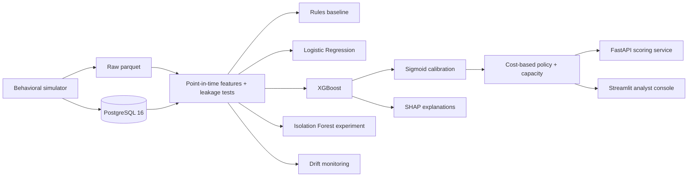

# FraudLens

[](https://github.com/rutujkale/fraudlens/actions/workflows/ci.yml)

An end-to-end **fraud-risk decision system**: a behavioral transaction simulator →
PostgreSQL → point-in-time features (with leakage tests) → Rules / Logistic
Regression / XGBoost under temporal validation → probability calibration →
cost-based decision policy with analyst-capacity limits → Isolation Forest
unseen-fraud experiment → SHAP → FastAPI + Streamlit → monitoring.

Synthetic data only (plus one public benchmark). This is a **portfolio / research
system, not a production banking system** — no claim of production readiness is
made anywhere.

> Every number below is filled from `results/final_results.json` and
> `results/latency.json` by `scripts/render_readme.py`; nothing here is typed by
> hand. The template is `docs/readme_template.md`.

## Why fraud risk is a different problem

- **Frauds are rare.** Test prevalence is {{composition.prevalence:.5f}}
  ({{headline.test.n_frauds}} frauds in {{composition.rows}} rows). Accuracy is
  meaningless, so PR-AUC, recall@top-K and expected cost are the headline metrics.
- **Legitimate behavior looks fraudulent.** Hard negatives (travel, payday,
  device sharing) are simulated explicitly and measured, not ignored.
- **Patterns move.** The fraud mix shifts over the timeline, so evaluation is
  strictly temporal with an embargo, and drift is a first-class finding.
- **Analysts are limited.** Reviews are capped per day; the policy trades fraud
  loss against friction and review workload.

## What I built



## What I found

Four pre-registered outcomes (`results/final_results.json`:

`pre_registered_outcomes`).

1. **Model.** Frozen XGBoost test PR-AUC {{headline.model.xgb_ci}}, ahead of
   LogReg {{headline.model.logreg_ci}} and far ahead of the rules baseline
   {{headline.model.rules_ci}} at {{headline.model.test_prevalence_pct}}
   prevalence. With {{headline.test.n_frauds}} test frauds the PR-AUC CI is wide, so
   read the point estimate with that in mind. (`H1_model` holds:
   {{pre_registered_outcomes.H1_model.holds}}.)
2. **Decision.** The amount-aware, capacity-aware policy cut realized fraud cost
   by **{{headline.decision.reduction}}** versus the F1-optimal threshold — the
   percentage is a **point estimate** and the interval is reported **in INR**
   ({{headline.decision.reduction_ci_inr}}), because the ratio's denominator is
   itself resampled. (`H2_decision` holds:
   {{pre_registered_outcomes.H2_decision.holds}}.)
3. **Drift and unseen fraud.** Concept drift is reported as
   **{{headline.drift.line}}**. {{headline.drift.post_switch}} (switch
   {{headline.drift.switch_date}}, inside the test window). The Isolation Forest
   result is {{headline.anomaly.note}}.
4. **Engineering.** {{headline.n_features}}-feature registry,
   {{headline.n_leakage_tests}} leakage tests, {{headline.n_tests}} automated
   tests collected. API p95 latency {{headline.engineering.latency}}
   (postgres, concurrency 1, in-process, dev; see limitations).

## Demo

**Live deployment** (free tier — the first request after ~15 min idle can take 30–50 s
while the Render API wakes):

- Analyst console: <https://fraud-lens.streamlit.app/>
- Scoring API: <https://fraudlens-api-pld9.onrender.com> — `/health` returns
  `{"status":"ok","model_version":"xgb_dev_20261015_v1", ...}`


*Landing page: profile/model/policy chips and the three console pages.*


*Transaction Analyzer: one transaction scored end-to-end (₹23,471 P2P transfer) → risk 73.2, BLOCK, with SHAP drivers.*

Screenshots captured from the live deployment; the local capture script lives in
`docs/screenshots/` (see its `README.md`), and the analyst walkthrough is in
`docs/demo_script.md`.

## Quickstart

```bash
make setup                 # venv + deps
make db-up                 # PostgreSQL 16 via docker compose
make simulate                    # dev profile (default PROFILE=dev)
make validate-data
make db-load
make build-features
make train
make calibrate
make optimize-policy
make api                   # terminal 1: scoring service
make app                   # terminal 2: Streamlit console
```

A full, ordered reproduction (including expected runtimes) is in
`docs/reproduce.md`. `make all-dev` runs the whole `dev` pipeline.

## Repo map

```
src/fraudlens/   data_gen  data_quality  db  features  models  evaluation  risk  explain  monitoring  appdata  reporting  api
app/             Streamlit console (three pages)
scripts/         thin CLI entrypoints (no business logic)
sql/             schema, indexes, views
tests/           unit, data, leakage, API and (db-marked) integration tests
docs/            methodology, model card, limitations, trade-offs, progress, experiments
results/         small CSV/JSON results (tracked)
reports/figures/ PNG figures (tracked)
```

## Limitations (short form)

- Synthetic data. Every subgroup/ fairness statement is about the **simulator's
  assumptions**, not real demographics. See `docs/limitations.md`.
- The test window holds {{composition.frauds}} frauds, so CIs are wide.
- Profile `main` was **never generated**; all published results are on the `dev`
  profile. See the deviations section in `docs/limitations.md`.
- Latency is an in-process lower bound: {{headline.engineering.latency_note}}.
  Rule: {{headline.engineering.latency_rule}}.
- Parity: {{headline.engineering.parity}}
- `ruff format` is **not** the repository style and is not enforced in CI; see
  `docs/limitations.md`.

## License

MIT (see `LICENSE`). The IEEE-CIS dataset is **not** redistributed.
